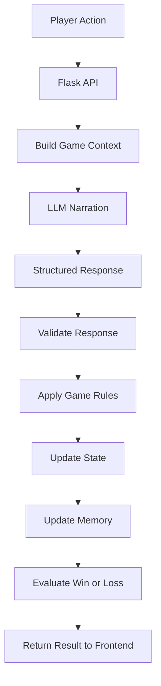

# Escape Silk Board — Design Decisions

## 1. The Moment

The most important design decision was separating AI narration from authoritative game-state management.

I wanted the player to interact naturally with Ramesh Uncle without allowing the LLM to invent money, battery, inventory or movement changes. The Python game engine validates every proposed state transition before applying it.

**Design principle:** The AI tells the story; the engine controls the rules.

## 2. The Cut

I deliberately kept the experience focused on a single journey rather than building a large open-world game.

Instead of introducing unnecessary mechanics, I prioritised a connected route system, limited resources, meaningful event choices, conversation history and character memory.

This allowed me to spend more time on state consistency, validation and gameplay testing.

## 3. The Miss

One limitation I identified is that validating structured game-state changes does not guarantee every sentence generated by an LLM is factually accurate.

I addressed this by injecting current game state into the narration context, validating proposed changes on the backend and overriding final win/loss narration using the authoritative outcome.

Ordinary narrative claims still need broader automated evaluation.

---

## Technical Architecture

The application uses Flask as the backend, a Python game engine for deterministic state transitions and HTML, CSS and JavaScript for the browser interface.

### Turn lifecycle



## State Management

The backend owns the authoritative game state, including:

- Current location
- Game time
- Cash
- Phone battery
- Inventory
- Turn count
- Conversation history
- Triggered events
- Game outcome
- Character memory

The frontend displays the returned state but does not determine authoritative game outcomes.

## Validation and Guardrails

The game engine validates:

- Available cash before payments.
- Battery bounds.
- Inventory availability and capacity.
- Legal connected destinations.
- Event existence and availability.
- Duplicate event prevention.
- Event-choice resource changes.
- Check-in deadline and final game outcome.

Only validated state changes are applied.

## Memory Design

The application maintains two separate forms of memory.

**Conversation memory:** Recent dialogue is included in the LLM context to support coherent interactions.

**Character memory:** Ramesh Uncle maintains a relationship score, behavioural traits and up to five remembered moments. Character memory is reset when a new game starts.

## Testing

The project uses Pytest with three test modules:

| Module | Coverage |
|---|---|
| `test_game.py` | Game rules and state validation |
| `test_game_engine.py` | Turn processing, events, outcomes and memory |
| `test_app.py` | Flask API behaviour |

**Verified result:** 34 tests passed.

Run the test suite:

```bash
python -m pytest -v
```

## Known Limitations

- Ordinary AI-generated narration is not guaranteed to be factually accurate.
- Game sessions currently use in-memory state rather than persistent database storage.
- Narrative consistency could benefit from a larger automated evaluation dataset.
- Production deployment requires additional security, monitoring and rate limiting.

## Future Improvements

1. Add persistent game-session storage.
2. Expand automated narrative consistency evaluation.
3. Improve observability of LLM latency and validation failures.
4. Expand browser-based end-to-end testing.
5. Deploy with managed secrets and production-grade configuration.