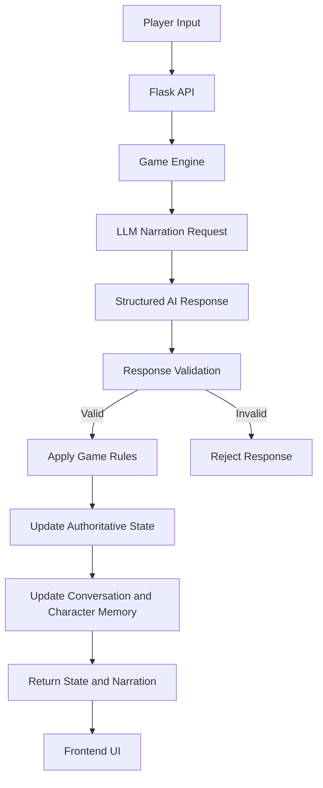

# Escape Silk Board 🛺
### An AI-Narrated, Server-Authoritative Text Adventure

**Escape Silk Board** is an interactive AI-powered text adventure set in Bengaluru. You're stranded at Silk Board at 7:00 PM. Your flight departs at 9:40 PM, check-in closes at 8:55 PM, and you have ₹500, a phone with 4% battery, and one cold samosa.

Your objective is simple: reach Kempegowda International Airport before check-in closes.

The challenge is not simply generating an interesting story. It's maintaining a consistent, rule-driven game world while allowing players to interact naturally with an AI narrator.

---

## 🎮 Gameplay

The player interacts with Ramesh Uncle, an auto driver who provides directions, reacts to decisions and remembers relevant interactions.

Every decision can affect:
- **Time:** Every action consumes time.
- **Cash:** Auto fares, alternative routes and other decisions affect your budget.
- **Battery:** Phone usage affects access to digital payments and services.
- **Location:** Movement follows a predefined, connected route network.
- **Inventory:** Items can be acquired, used or sold.
- **Relationships:** Interactions influence Ramesh Uncle's character memory.

The game supports winning and losing outcomes based on the actual game state, rather than the AI narrator's opinion.

---

## 🏗️ Architecture and Design

### Server-authoritative game state

The most important architectural decision is separating game logic from AI-generated narration.

The LLM does not independently control the game's economy, movement or progression. The backend owns the authoritative state and validates proposed changes before applying them.



### Why this design?

1. The player submits a natural-language action through the frontend.
2. Flask receives the request and constructs a prompt using the current server-side game state.
3. The language model generates narration and a structured response describing proposed game changes.
4. The game engine validates the response against the game's rules.
5. Only validated changes are applied to the authoritative state.
6. The updated state, narration and relevant hints are returned to the frontend.

This prevents the language model from independently deciding that the player has more money, extra battery, a new item or an impossible location.

---

## 🧠 AI, Conversation and Character Memory

### AI narration

Ramesh Uncle is the game's narrator and interactive character. The model receives contextual information about the player's current situation, available choices, legal destinations and recent interactions.

The application uses a Groq-first model integration with a Gemini fallback.

### Conversation memory

Recent conversation history is included in the model context so that the narrator can respond consistently to earlier player actions and questions.

The backend includes recent conversation turns in its state description, with the latest six turns used as context.

### Character memory

Character memory is maintained separately from ordinary conversation history.

Ramesh Uncle's memory tracks:
- Relationship score, bounded between -5 and +5.
- Behavioural traits inferred from player actions.
- Remembered interactions, retaining the latest five moments.

This allows interactions to influence how the character remembers and responds to the player. A new game resets the character memory.

---

## 🛡️ Game Rules and AI Guardrails

An AI-generated response is treated as a proposal, not as an authoritative game-state update.

The backend validates proposed changes before applying them.

Important safeguards include:

- **Location validation:** Movement must follow legal connected destinations.
- **Cash validation:** Payments cannot exceed available funds or produce negative cash.
- **Battery validation:** Battery cannot fall below zero.
- **Inventory validation:** Items must exist before removal, and inventory capacity is limited.
- **Event validation:** Events must exist, be available at the current location and not have already occurred.
- **Choice validation:** Event choices must match configured outcomes and their exact resource changes.
- **Time validation:** Time progression is checked against game rules.
- **Outcome consistency:** Winning and losing narration is determined by the final game state, not by an unsupported AI claim.

The game engine is responsible for applying accepted changes. This keeps the AI responsible for storytelling while application code remains responsible for game correctness.

---

## 🧰 Technology Stack

| Component | Technology |
|---|---|
| Backend | Python, Flask |
| Frontend | HTML, CSS, JavaScript |
| AI integration | Groq, Gemini fallback |
| Game engine | Python |
| Testing | Pytest |
| Version control | Git, GitHub |

---

## 📁 Project Structure

```text
escape-silk-board/
│
├── app.py
│
├── game/
│   ├── game_state.py
│   ├── rules.py
│   ├── game_engine.py
│   └── game_events.py
│
├── static/
│   └── index.html
│
├── tests/
│   ├── test_game.py
│   ├── test_game_engine.py
│   └── test_app.py
│
├── requirements.txt
├── .env.example
├── .gitignore
├── README.md
└── DESIGN.md
```

---

## ⚙️ Getting Started

### Prerequisites

- Python 3
- pip
- Git
- API credentials for the configured AI providers

### 1. Clone the repository

Open the GitHub repository and copy its HTTPS clone URL.

```bash
git clone <YOUR_REPOSITORY_CLONE_URL>
cd escape-silk-board
```

### 2. Create a virtual environment

**Windows (PowerShell):**

```powershell
python -m venv venv
venv\Scripts\Activate.ps1
```

**macOS / Linux:**

```bash
python3 -m venv venv
source venv/bin/activate
```

### 3. Install dependencies

```bash
pip install -r requirements.txt
```

### 4. Configure environment variables

Create a `.env` file in the project root using `.env.example` as the reference.

Add the required API credentials using the exact variable names defined in the example file.

Never commit `.env` or expose API keys in a public repository.

### 5. Start the application

```bash
python app.py
```

Open the application in your browser:

`http://127.0.0.1:3000`

---

## 🧪 Testing

The project uses Pytest and has three test modules:

| Test file | Responsibility |
|---|---|
| `test_game.py` | Game rules, state changes and validation |
| `test_game_engine.py` | Turn processing, events, outcomes and character memory |
| `test_app.py` | Flask application and API behaviour |

### Run the complete test suite

```bash
python -m pytest -v
```

**Verified test result:** 34 tests passed in the project test run.

The tested scenarios include:
- Valid and invalid game-state changes.
- Unaffordable payments and negative battery prevention.
- Invalid inventory removal.
- Duplicate events and invalid event IDs.
- Events triggered from the wrong location.
- Samosa sale behaviour.
- Successful airport arrival.
- Missing the check-in deadline.
- Character memory reset on a new game.

---

## 💬 Example Gameplay

The following illustrates a verified opening interaction from a browser test.

**Initial state**

| Resource | Value |
|---|---|
| Time | 7:00 PM |
| Cash | ₹500 |
| Battery | 4% |
| Inventory | 1 cold samosa |
| Location | Silk Board |
| Turn | 0 |

**Player:**

> I ask Ramesh Uncle which route is fastest to the airport.

**Ramesh Uncle:**

> He points toward Outer Ring Road and explains that Silk Board traffic is heavily congested.

**Updated state**

| Resource | Value |
|---|---|
| Time | 7:05 PM |
| Cash | ₹500 |
| Battery | 4% |
| Inventory | 1 cold samosa |
| Location | Silk Board |
| Turn | 1 |

The interaction demonstrates that a conversation-only turn advances time without arbitrarily changing cash, battery, inventory or location.

---

## ⚖️ Engineering Decisions and Trade-offs

### Why keep game state outside the LLM?

Allowing an LLM to directly control game resources would make outcomes unpredictable. Separating narration from state transitions provides deterministic rule enforcement and makes the game easier to test.

### Why use structured AI responses?

Structured responses allow the backend to validate proposed actions and resource changes rather than relying on free-form narration to update the game.

### Why maintain two kinds of memory?

Conversation history supports contextual dialogue, while character memory represents longer-lived interactions and relationship changes. Keeping them separate gives the game a clearer memory model.

---

## 🚧 Limitations and Future Improvements

With additional development time, I would focus on:

1. **Narration evaluation:** Expand automated checks to detect unsupported factual claims in AI-generated narration.
2. **Persistent sessions:** Store game sessions in a database instead of relying on in-memory session state.
3. **Observability:** Add structured metrics for model latency, failures, validation rejections and fallback usage.
4. **Frontend improvements:** Add richer route visualisation and more comprehensive browser-based testing.
5. **Deployment:** Deploy the application with managed secrets, production configuration and appropriate API rate limits.

---

## 👨‍💻 Author

**Irfan Ahmed**

- GitHub: [Irfan240305](https://github.com/Irfan240305)

---

*Built with Python, Flask and AI-powered narration. The AI tells the story; the game engine controls the rules.*